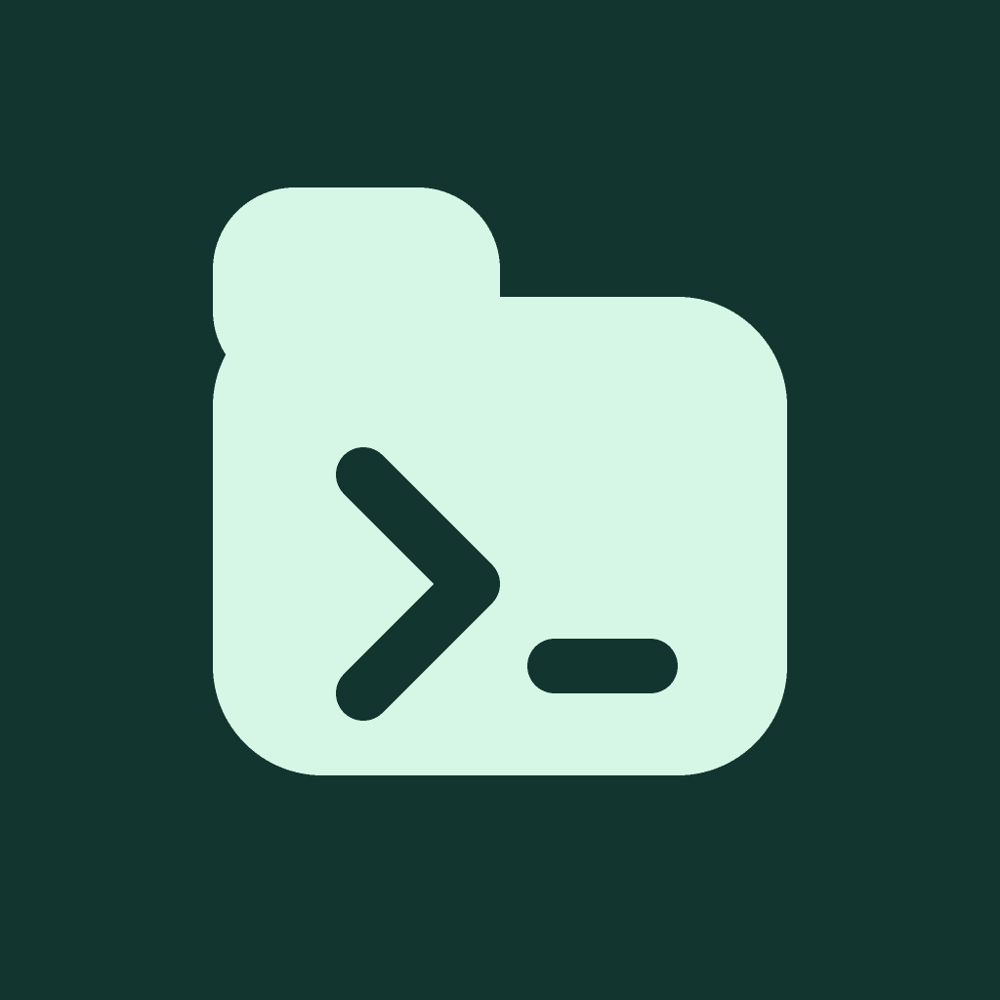

# Codex CLI Tabs

An unofficial, open-source VS Code extension for running multiple independent
Codex CLI sessions as editor-area terminal tabs.

> This extension is not affiliated with or endorsed by OpenAI. Codex CLI must
> be installed and authenticated separately.

<p align="center">
  
</p>

## Features

- Open Codex in an editor tab beside the current editor.
- Create multiple independent chats in one reusable editor group.
- Start unnamed tabs as **Codex CLI**, then follow the current session's
  generated or explicit title.
- Reveal the most recently used live Codex tab without creating a duplicate.
- Resume or fork a saved Codex chat in a new tab using the native CLI picker.
- Insert files and folders as relative or absolute `@` mentions.
- Move an editor tab into the Codex group to insert its path into the chat.
- Support local, multi-root, and remote workspaces.

Codex CLI remains responsible for conversations, persistence, authentication,
models, permissions, tools, and network traffic. This extension does not store
prompts, credentials, or chat history and does not collect telemetry.

## Requirements

Install and sign in to Codex CLI, then confirm it resolves in the environment
where the VS Code extension host runs:

```bash
codex --version
```

See the [official Codex CLI documentation](https://developers.openai.com/codex/cli/features)
for installation and authentication. With no folder open, a chat starts in
your home directory. Open a workspace when you want Codex scoped to a project.

On macOS and Linux, Python 3 with the
standard Unix `pty` module enables compact terminal titles and verified
file-drop rewriting. Codex Tabs requests an internal session identifier for
each managed terminal without changing your global Codex configuration. When
Codex shortens that identifier for terminal display, the adapter resolves the
validated prefix to one unique session before reading only its bounded
`name`/`title` metadata from Codex's local state. It then displays the sanitized
title. It does not read the conversation transcript or store title metadata.

## Commands

| Command | Description |
| --- | --- |
| **Codex Tabs: Open Agent** | Reveal the most recently used live tab, or create one. |
| **Codex Tabs: New Agent Chat** | Start an independent `codex` session. |
| **Codex Tabs: Resume Chat…** | Open `codex resume` in a new tab. |
| **Codex Tabs: Fork Chat…** | Open `codex fork` in a new tab. |
| **Codex Tabs: Insert into Chat** | Insert selected files or folders into the active Codex tab. |

The New Agent Chat command is also available from the editor title. Insert into
Chat is available from Explorer and editor context menus.

The resume and fork commands intentionally use Codex's native saved-session
picker. The [official CLI command reference](https://developers.openai.com/codex/cli/reference)
documents both commands and their working-directory behavior.

## Settings

| Setting | Default | Description |
| --- | --- | --- |
| `codexTabs.command` | `codex` | Executable name or absolute path. Shell expressions are not supported. |
| `codexTabs.args` | `[]` | Global CLI arguments placed before `resume` or `fork`. |
| `codexTabs.cwdMode` | `auto` | Working-directory policy: `auto`, `workspaceRoot`, or `prompt`. A folder-specific value follows the active file. |
| `codexTabs.launchMode` | `loginShell` | Use a login shell on Unix or the configured terminal profile. |
| `codexTabs.titleMaxLength` | `28` | Maximum compact title length on macOS and Linux. |

Example:

```json
{
  "codexTabs.args": ["--model", "gpt-5.6-terra", "--no-alt-screen"]
}
```

## Platform support

- **macOS and Linux:** full support with Python 3 and Unix PTY modules.
- **Windows:** editor tabs, group reuse, commands, and context-menu insertion.
  `loginShell` launches a resolved `.exe` directly, or a `.cmd`/`.bat` shim
  through `cmd.exe` with quoted arguments. Unix PTY title and drop integration
  is unavailable.
- **Remote environments:** supported when Codex CLI and Python are installed in
  the remote extension host.
- **Browser-only VS Code:** unsupported without a remote extension host.

If the optional Python adapter or compatible Codex title metadata is
unavailable, the extension falls back to the stable **Codex CLI** tab name.
Core tab and command behavior remains available.

## Troubleshooting

This extension does not install Codex CLI or sign in for you. If the configured
absolute path does not exist, or Windows `loginShell` mode cannot resolve the
command, no tab is opened. If a tab exits immediately, it stays open so you can
read the CLI output, and VS Code shows a setup message. Confirm `codex --version`
in a terminal, then run `codex` once to sign in.

Python discovery for compact titles is cached until the window reloads. Insert
into Chat needs a file or folder selection and an open Codex tab.

## Privacy

Codex CLI Tabs does not collect telemetry or store prompts, credentials, or
chat transcripts. See [PRIVACY.md](PRIVACY.md). Codex CLI has its own terms
and network behavior.

## Development

```bash
npm ci
npm run check
npm run package
```

See [CONTRIBUTING.md](CONTRIBUTING.md) and
[docs/ARCHITECTURE.md](docs/ARCHITECTURE.md).

## License

MIT. See [NOTICE](NOTICE) for attribution and trademark information.
