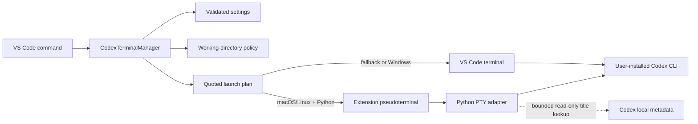

# Architecture

Codex CLI Tabs is a thin editor integration around a user-installed Codex CLI.

`src/codexTerminalManager.ts` is the stateful coordinator. Other modules
validate inputs, build immutable plans, or adapt one I/O boundary.

| Module | Responsibility |
| --- | --- |
| `configuration.ts` | Validate settings and bounded defaults. |
| `launchDiagnostics.ts` | Resolve Windows executables and classify startup failures. |
| `workingDirectory.ts` | Select the workspace/home directory. |
| `sessionLaunch.ts` | Place global arguments before `resume` or `fork`. |
| `launch.ts` | Quote executable arguments and create platform launch plans. |
| `pathMentions.ts` | Format verified resources as Codex `@` mentions. |
| `dropInterception.ts` | Detect an editor moved into a managed Codex group. |
| `titleParser.ts` | Parse bounded titles emitted by the adapter. |
| `pythonBridge.ts` | Detect Unix PTY support and build bridge arguments. |
| `codexPseudoterminal.ts` | Connect VS Code terminal events to the adapter. |
| `scripts/codex-pty-bridge.py` | Relay a Unix PTY, resize it, rewrite verified path drops, and resolve session titles. |

Managed sessions are identified only by concrete `vscode.Terminal` objects.
Only terminals created during the current extension-host lifetime are managed.
The tabs themselves are transient; Codex CLI persists chat history and exposes
the native `resume` and `fork` pickers.

For managed Unix terminals, Codex is given a process-local title layout that
contains its app name, session UUID, and explicit thread name. Codex may shorten
the UUID in this display surface. The bridge accepts only a validated full UUID
or truncated UUID prefix, requires a prefix to identify one unique row, and
never displays either form. It uses parameterized lookups against Codex's local
`state_*.sqlite` metadata and reads at most 256 characters from the current
row's identifier, `name`, `title`, or compatibility `preview` fields. Explicit
names take precedence over generated titles. Results are sanitized, bounded by
`codexTabs.titleMaxLength`, kept only in memory, and never logged. Missing or
ambiguous identifiers, SQLite support, files, or schema fields degrade to
`Codex CLI` without affecting the Codex process. Native-terminal fallback
requests only the app name.

Configured executable and argument values are never interpreted as arbitrary
shell syntax. POSIX values are quoted individually. Windows `loginShell` mode
launches a resolved `.exe` directly. A `.cmd` or `.bat` shim is started with
`cmd.exe /d /s /c` and percent-escaped quoted arguments, so environment
variables are not expanded. The optional PTY adapter degrades to a native
terminal when unavailable. A bare command that a Unix login shell or a
terminal profile must resolve is not rejected in advance. An absolute path
that does not exist is rejected before a tab opens.
